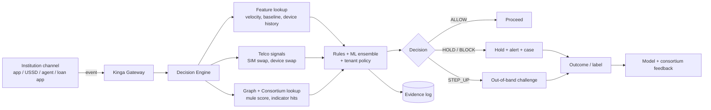

# Kinga — Fraud & SIM-Swap Intelligence for Kenyan Finance

> **Working name.** *Kinga* is Swahili for "protection". Rename freely.
> **Status:** Phase 1 foundation implemented; partner staging and exit gates remain open. Companion docs: [`Phases.md`](./Phases.md) (how we build it) and [`Structure.md`](./Structure.md) (how the system and repo are laid out).

## Phase 1 implementation in this repository

The Phase 1 shadow-mode path uses a **Rust decision engine** behind a Go public gateway, following the language split in `Structure.md`. The gateway owns client authentication, validation, rate limits, idempotency and evidence. Rust owns policy loading, rule evaluation, scoring, reason generation and decision resolution.

```sh
cargo build --manifest-path engine/Cargo.toml
KINGA_POLICY_PATH=policies/default.json cargo run --manifest-path engine/Cargo.toml
KINGA_API_KEYS='demo:demo-key:demo-secret' KINGA_ENGINE_URL=http://127.0.0.1:8090 go run ./services/gateway/cmd
```

The gateway listens on `:8080`; `GET /healthz` is public, and `/readyz` checks the Rust engine. The engine listens on `:8090` for the gateway's internal request contract. `POST /v1/assess` requires `X-Kinga-Key`, `X-Kinga-Timestamp` (Unix seconds), `X-Kinga-Signature` (hex HMAC-SHA256 of `timestamp + "." + exact request body`), and an `Idempotency-Key` equal to `tenant_event_id`. The timestamp window is five minutes. The included replay tool signs requests automatically. `docker compose up --build` starts both services; the local demo key is for development only. The gateway has a 100 ms engine timeout and returns `503` if it cannot obtain a decision.

The gateway computes device/beneficiary first-seen and 15-minute velocity features from tenant-scoped local history, storing only keyed hashes of identifiers in memory. The Go telco interface currently uses a deterministic simulator fixture; unknown numbers return an unavailable signal and set `degraded: true`. Balance-drain, account-age and inbound fan-in features still come from the institution/replay event. Phase 1 transaction amounts must be denominated in KES; other currencies are rejected until an FX source and conversion policy are defined. Kenyan `occurred_at` timestamps retain the `+03:00` offset used by the overnight feature. The Rust engine loads `policies/default.json` at startup, validates the rule IDs, weights and score bands, and evaluates the supported starter rules. Decisions always include `mode: shadow`, explainable reason codes and a reference to a hash-chained evidence record. Evidence records include the raw event hash, derived feature snapshot and decision. Evidence is stored at `data/evidence.jsonl` by default (`GET /v1/evidence/verify` checks the chain). `GET /metrics` exposes the initial service metric.

Generate canonical synthetic events and a separate label sidecar with `python3 tools/synth/generate.py --count 1000 --out synthetic.jsonl`, then replay them against a running service with `python3 tools/replay/replay.py synthetic.jsonl --labels synthetic.labels.jsonl`. The generator covers SIM-swap account takeover, beneficiary velocity abuse, balance drain, young-account fan-in/fan-out, and agent-float structuring. Synthetic labels measure pipeline mechanics only; they are not evidence of real-world detection performance. CSV rows can be converted and replayed with `python3 tools/ingest/csv_to_jsonl.py input.csv events.jsonl`; Parquet conversion is optional with `pyarrow`. API contract: [`schemas/openapi/openapi.yaml`](./schemas/openapi/openapi.yaml); canonical event schema: [`schemas/events/assessment.schema.json`](./schemas/events/assessment.schema.json); Rust RPC contract: [`schemas/engine/assess-request.schema.json`](./schemas/engine/assess-request.schema.json) and [`schemas/engine/assess-response.schema.json`](./schemas/engine/assess-response.schema.json); starter policy: [`policies/default.json`](./policies/default.json).

This remains a development/staging foundation: idempotency uses Redis in Compose and remains process-local when Redis is unset; feature history is process-local; evidence is a single-writer local file; CSV/Parquet conversion is a CLI replay path rather than scheduled SFTP ingestion. Postgres/NATS, live Safaricom connectivity, the investigator console, full OpenTelemetry instrumentation, staging runbooks, and partner-data backtests remain open Phase 1 work. The exit gate has not been met. The Redis + stub-scorer latency spike can be run using [the latency-spike guide](./docs/runbooks/latency-spike.md); its measurement remains pending.

## Phase 2 model and outcome loop

The repository includes an offline, chronological gradient-boosted model pipeline with separate calibration and future holdout windows, Platt probability calibration, a calibration-set threshold at a configured false-positive ceiling, evaluation metrics/slices/drift indicators, ONNX export, and Rust-side ONNX inference. The ordered numeric feature contract is [`schemas/features/v1.json`](./schemas/features/v1.json). The authenticated `POST /v1/outcomes` endpoint writes reviewer labels to a local append-only, hash-chained ledger at `KINGA_OUTCOME_PATH` (default `data/outcomes.jsonl`). Flagged decisions create tenant-scoped cases; `/v1/cases` supports review assignment/disposition and `/v1/cases/{caseID}/evidence` exports the case plus its verified evidence record as JSON.

See [`docs/ml/phase-two-model-loop.md`](./docs/ml/phase-two-model-loop.md) for dataset preparation, training, evaluation, labels and model deployment. Install the optional offline dependencies with `python3 -m pip install -r requirements-ml.txt`. Train only on approved partner data; synthetic generator metrics do not establish real fraud lift. The model remains shadow-only and Phase 2 exit gates remain open.

---

## 1. The pitch in one paragraph

Kinga sits between a financial institution's channels (mobile app, USSD, paybill, agents, loan apps) and the moment money moves. For every sensitive event it answers one question in **under 150 ms**: *"Is this really the customer, and is this money going somewhere it shouldn't?"* It does this by fusing **telco signals** (SIM swap, device change), **behavioural baselines**, a **mule-network graph**, and a **privacy-preserving consortium** of confirmed fraud indicators shared across institutions. It returns `ALLOW`, `STEP_UP`, `HOLD` or `BLOCK` with human-readable reason codes, and records a tamper-evident evidence trail that the institution can use with regulators, customers and courts.

It is an **API and network**, not another dashboard.

---

## 2. The problem

### 2.1 The scale (what public data says)

| Signal | Figure | Source |
|---|---|---|
| Reported cyber-fraud cases in Kenyan banks | 173 (2023) → 353 (2024) | CBK data, as reported by [Business Daily](https://www.businessdailyafrica.com/bd/corporate/companies/hackers-steal-sh1-59-billion-from-kenya-bank-customers-5186982) |
| Losses absorbed by the sector | ~KSh 412M (2023) → ~KSh 1.59B (2024), roughly 4× | [Khusoko summary of CBK report](https://khusoko.com/2025/09/15/kenyas-banking-sector-faces-cybersecurity-reckoning-as-fraud-losses-quadruple/) |
| Share from mobile banking | ~KSh 810M, just over half of 2024 losses | same |
| Mobile money users who lost money to fraud | nearly 10% (FinAccess 2024) | [People Daily](https://peopledaily.digital/insights/how-kenyans-can-avoid-mobile-wallet-and-cyber-fraud/amp) |
| Mobile money as the destination of illicit funds | 51 of 102 documented cases, H1 2026 | [NC4 report via Kenyans.co.ke](https://www.kenyans.co.ke/news/126452-mobile-money-emerges-kenyas-biggest-fraud-channel-nc4-report-shows) |
| SIM-swap investigations | +327%, with 123,000+ fraudulent SIMs detected (East Africa assessment) | [Interpol via AllAfrica](https://allafrica.com/stories/202608050481.html) |

> **Caveats.** Figures differ slightly between outlets (e.g. some report 153 rather than 173 cases for 2023). Banks also under-report: [lenders may avoid reporting for reputational reasons](https://www.businessdailyafrica.com/bd/corporate/companies/hackers-steal-sh1-59-billion-from-kenya-bank-customers-5186982), and some losses blamed on "hackers" [may involve insiders](https://techcabal.com/2025/09/17/kenya-central-bank-blames-hackers-mobile-banking-fraud/). Treat all numbers as a floor.
>
> **A nuance that shapes the product:** in the NC4 H1-2026 sample, pure SIM-swap cases were a small share (3 of 102), yet single SIM-swap cases can be very expensive. SIM swap is the *sharpest signal*, not the whole problem. Kinga is therefore built as **account-takeover and mule-network intelligence**, with SIM swap as its highest-weighted input.

### 2.2 Why today's defences leak — six failure modes

| # | Failure mode | What happens | Evidence |
|---|---|---|---|
| 1 | **The telco/bank blind spot** | The SIM swap happens at the telco; the loss happens at the bank, lender or wallet. The institution that loses the money often does not know the swap occurred. | Safaricom [built a SIM-Swap-Check API for banks](https://hapakenya.com/2023/03/02/safaricoms-sim-swap-check-service-adopted-by-6-banks-in-order-to-curb-fraud) precisely because of this gap. |
| 2 | **Point signals, no fusion** | A SIM-swap flag alone is a yes/no. Without device, behaviour and beneficiary context it creates either missed fraud or friction for honest customers. | A raw "last swapped" timestamp still needs a decision layer on top. |
| 3 | **Each institution sees only its own slice** | Mule accounts and fraud beneficiaries are reused across banks, wallets and lenders. Nobody sees the whole network. | The DPP has [highlighted distributed mule networks](https://allafrica.com/stories/202611030084.html) used to move illicit funds. |
| 4 | **Wrong time, wrong people** | Attacks cluster [late at night on weekends](https://www.money254.co.ke/post/kenyans-lose-ksh1-59-billion-to-fraudsters-targeting-banks-news), when manual review is thinnest. | CBK data cited by Money254. |
| 5 | **Agents and insiders** | Coordinated groups distract agents while a swap is executed ([Marsabit case, July 2026](https://www.dawan.africa/news/eight-suspects-arrested-over-ksh-12-million-m-pesa-fraud-in-marsabit)); insiders are a recurring theme. | DCI statement; [Standard on Equity internal-theft cases](https://standardmedia.co.ke/business/amp/crime-and-justice/article/2001543516/from-kigali-to-nairobi-equity-bank-hit-by-a-string-of-heists). |
| 6 | **Small institutions have no tooling** | SACCOs, microfinance banks and digital lenders rarely have enterprise fraud engines, yet they are on the same rails. | Tier-1 banks buy global tools; the long tail does not. |

### 2.3 The liability shift (the commercial trigger)

In 2026 the High Court in Machakos held that **both the telco and the bank** bear responsibility in a SIM-swap case: [Safaricom 60%, DTB 40%](https://techcabal.com/2026/07/13/kenyan-court-holds-banks-telcos-liable-over-sim-swap-fraud/). Per that reporting, the bank's independent breach was failing to detect and halt a *series of suspicious transactions*, and the court rejected the argument that a non-business day put the pattern outside normal monitoring. The [customer lost about KSh 4.4M](https://techpoint.africa/?p=356772).

Separately, CBK has said it plans to work toward a [digital-fraud compensation framework by the end of 2026](https://peopledaily.digital/insights/how-kenyans-can-avoid-mobile-wallet-and-cyber-fraud/amp).

**Implication:** "we didn't see it" is becoming an expensive defence. Institutions need (a) detection that works on weekends and at night, and (b) **evidence** that they detected, decided and acted reasonably. Kinga sells both.

### 2.4 What is *not* broken (don't rebuild it)

Safaricom already offers banks a **SIM-Swap-Check API** (last-swap timestamp; free monthly quota, premium above it) and an ATM Vicinity Check. Kinga **consumes** that signal; it does not compete with it. The gap Kinga fills is everything *around* it: fusion, graph, consortium, decisioning, evidence, and coverage for institutions and networks that are not wired up.

---

## 3. What Kinga does

1. **Real-time risk API.** One call per sensitive event: onboarding, login, device change, SIM change notice, beneficiary add, transfer, loan application, limit change, agent float movement.
2. **Signal fusion.** Telco, device, behaviour, beneficiary reputation, identity consistency.
3. **Mule-network graph.** Detects fan-in/fan-out, rapid pass-through, shared devices/SIMs/beneficiaries, and young or tier-1 wallets acting as relays.
4. **Consortium intelligence.** Institutions contribute *confirmed* fraud indicators as irreversible tokens. Everyone benefits from what any member has already seen, without exchanging raw customer data.
5. **Decision + reason codes.** `ALLOW | STEP_UP | HOLD | BLOCK`, each with ranked, plain-language reasons and configurable per-tenant policy.
6. **Step-up orchestration.** Out-of-band confirmation via USSD push, SMS callback, in-app challenge or branch/agent verification.
7. **Case management.** Investigator queue, labelling (confirmed fraud / false positive), feedback loop into models and the consortium.
8. **Evidence packs.** Tamper-evident record of inputs, policy and model versions, decision, timestamps and actions. Exportable for disputes, regulators and litigation.
9. **Shadow mode and backtest.** Run read-only on historical or live logs first, prove value before anyone changes a production flow.

---

## 4. How a decision is made



**Layered logic (cheap and explainable first):**

1. **Hard rules**: policy guardrails (e.g. "swap < 24h + new beneficiary + amount over threshold → STEP_UP minimum").
2. **Behavioural model**: gradient-boosted trees over velocity, baseline deviation, time-of-day, session and device features.
3. **Graph score**: mule-likelihood of the beneficiary and subject neighbourhood.
4. **Consortium hits**: number of *independent* institutions that confirmed fraud for this indicator, with decay.
5. **Policy resolver**: maps score + reasons to the tenant's configured action, with explicit fail-open/fail-closed behaviour when a dependency times out.

Every response lists which layer contributed what. No black-box verdicts.

---

## 5. A worked example (illustrative, not real data)

Saturday, 22:14. A customer's SIM is replaced. 38 minutes later:

- New device logs into the bank app; OTP delivered to the new SIM.
- Three transfers in 12 minutes to two **new** beneficiaries, together draining ~85% of the balance.
- One beneficiary account is already flagged by **two other institutions**.

| Layer | Contribution |
|---|---|
| Telco | SIM replaced 38 min ago (high weight) |
| Device | First-seen device (medium) |
| Behaviour | Balance-drain pattern, far outside 90-day baseline (high) |
| Graph/consortium | Beneficiary hit by 2 independent institutions (high) |

**Result:** `HOLD` on transfer #2, out-of-band step-up to the customer's *registered* channel, case opened, evidence pack written. Under the 2026 court reasoning, the institution can now show it detected the pattern and acted, on a weekend night.

---

## 6. API sketch

`POST /v1/assess`

```json
{
  "tenant_event_id": "evt_01J9ZK3Q",
  "event_type": "funds_transfer",
  "occurred_at": "2026-10-31T22:14:09+03:00",
  "channel": "mobile_app",
  "subject": { "msisdn": "+2547XXXXXXXX", "account_ref": "acc_8841", "customer_ref": "cus_1021" },
  "device": { "device_id": "dvc_a1f3", "ip": "197.x.x.x", "app_version": "5.2.1" },
  "transaction": {
    "amount": 250000, "currency": "KES", "rail": "pesalink",
    "beneficiary": { "type": "bank_account", "ref": "ben_77ac" }
  }
}
```

Response:

```json
{
  "decision": "HOLD",
  "risk_score": 0.93,
  "risk_band": "critical",
  "reasons": [
    { "code": "SIM_SWAP_RECENT", "detail": "SIM replaced 38 minutes ago", "weight": 0.41 },
    { "code": "BALANCE_DRAIN_PATTERN", "detail": "3 transfers, 85% of balance in 12 min", "weight": 0.24 },
    { "code": "BENEFICIARY_CONSORTIUM_HIT", "detail": "confirmed by 2 institutions", "weight": 0.22 },
    { "code": "NEW_DEVICE", "weight": 0.13 }
  ],
  "recommended_actions": ["STEP_UP_OUT_OF_BAND", "NOTIFY_FRAUD_TEAM"],
  "degraded": false,
  "latency_ms": 74,
  "evidence_id": "ev_01J9ZK3R",
  "policy_version": "2026-10-28.3",
  "model_version": "gbm-0.4.1"
}
```

Plus: `POST /v1/outcomes` (labels), `POST /v1/indicators` (contribute to consortium), `GET /v1/evidence/{id}`, webhooks for step-up results and case events.

---

## 7. Signal catalogue

| Signal | Source | Status |
|---|---|---|
| SIM last-swapped | Safaricom SIM-Swap-Check API | **Exists** (launched 2023 with six banks). Access terms per institution need confirming. |
| SIM swap on Airtel / Telkom | MNO integrations | **To validate.** Availability unknown. |
| Standardised telco APIs (SIM swap, device swap, number verification) | CAMARA / GSMA Open Gateway ([spec](https://opengateway.telefonica.com/en/apis/sim-swap)) | **Adapter-ready, availability in Kenya unconfirmed.** We design to the standard so new telcos plug in. |
| Device fingerprint, device-account binding | Institution SDK / app signals | Build. |
| Velocity, baseline deviation, time-of-day | Institution events | Build. |
| Beneficiary reputation | Graph + consortium | Build. |
| Identity consistency (name/ID/number match) | Institution KYC data, optional IPRS-based vendors | Partner, do not rebuild KYC. |
| USSD session anomalies | Institution/aggregator logs | Build (differentiator: many competitors are device-signal-first, USSD users lack device signals). |

**Degrade gracefully:** if no telco signal is available, Kinga still scores on device, behaviour and graph, and says so in `degraded: true`.

---

## 8. Privacy, legal and trust by design

This is the part that can kill the company if done carelessly, so it is a first-class feature.

- **Data Protection Act, 2019.** Register with the ODPC, run a DPIA before any production data. Per KBA, banks have cited [the absence of a clear legal framework for sharing customer personal data](https://eastleighvoice.co.ke/tax%20evaders/116814/banks-resist-kra-s-push-for-system-integration-over-personal-data-privacy-concerns?amp=1), and ODPC has [fined banks for unlawful sharing of a borrower's data](https://itweb.africa/article/kenyan-banks-face-wrath-of-law-over-data-breaches/wbrpOqg2ZO8MDLZn). **Get a Kenyan data-protection advocate's written opinion on the consortium design before Phase 3.**
- **No raw PII crosses institutions.** Consortium indicators are keyed-hash tokens (HMAC with rotating network keys), with a minimum number of independent confirmations before an indicator is visible, expiry/decay, and a dispute/removal workflow.
- **Data minimisation.** Tenants send references and tokens where possible; MSISDNs are normalised and tokenised at the edge; raw values are encrypted with per-tenant keys.
- **Tenant isolation.** Per-tenant encryption keys, row-level security, no cross-tenant reads except through the consortium token path.
- **Explainability.** Every decision carries reason codes; models are versioned; policy is human-readable.
- **Customer fairness.** Track false-positive rate and friction per segment; a `HOLD` must always have a fast, humane path to resolution.
- **Retention.** Defined per data class; evidence records retained for the dispute window, then archived or deleted.

---

## 9. Competitive landscape and our wedge

| Player | What they do | Gap Kinga targets |
|---|---|---|
| **Safaricom SIM-Swap-Check** | Raw swap timestamp for banks | Signal only: no fusion, graph, consortium or evidence. Kinga consumes it. |
| **Youverify, Smile ID, Sumsub, Dojah** | KYC/identity verification, AML monitoring | Identity-at-onboarding focused; less on live account-takeover and mule flows over Kenyan rails and USSD. |
| **Periculum, [Prembly Fraudlens](https://allafrica.com/stories/202603160102.html)** and other African fraud startups | Real-time fraud scoring for fintechs and lenders | Competition is real and growing. Our edge must be Kenya depth + consortium network effect + evidence. |
| **Global fraud suites (FICO, etc.)** | Enterprise engines | Price and integration weight put them out of reach of SACCOs, MFBs and digital lenders. |

**Wedge (in order of defensibility):**
1. **Consortium network effect.** Every member makes every other member safer. This compounds and is hard to copy once live.
2. **Evidence-grade audit trail** aligned to the liability shift.
3. **Kenya-native depth:** M-Pesa/PesaLink/USSD behaviour, SACCO and agent-network patterns, Swahili/Sheng-aware step-up messaging.
4. **Fast time-to-value:** shadow-mode backtests on an institution's own history within days.
5. **Embeddable core** for institutions that must run on-prem.

> **Be honest about this:** the space is not empty, and Safaricom could widen its own offering. If the consortium does not reach critical mass, Kinga is "another scoring API". See kill criteria in `PHASES.md`.

---

## 10. Who buys first

| Segment | Why first | Entry motion |
|---|---|---|
| **Digital lenders and MFBs** | High fraud exposure, thin tooling, fast decisions | Shadow-mode backtest, then API |
| **SACCOs (via core-banking vendors)** | Large long tail, active cyber concern | Partner with 1–2 core-banking/USSD vendors, embed Kinga |
| **Tier-2/3 banks** | Real losses, shaky in-house detection | Pilot on one channel (e.g. mobile banking) |
| **Payment aggregators / wallets / agent networks** | Mule and float abuse | Graph + agent-risk module |

Large tier-1 banks come later, via the consortium (their confirmed indicators are the most valuable data).

---

## 11. Success metrics

- **Detection:** recall at a fixed false-positive rate (e.g. share of confirmed fraud caught before funds leave, at ≤ 0.5% customer friction).
- **Prevention:** KSh held/blocked that was later confirmed fraud vs. KSh of legitimate value delayed.
- **Speed:** p99 API latency ≤ 150 ms; time from confirmed fraud to consortium indicator ≤ 5 minutes.
- **Trust:** false-positive customer complaints per 10,000 decisions; mean time to release a wrongly held transaction.
- **Network:** active institutions, indicators contributed, cross-institution "saves".
- **Evidence:** share of disputed cases resolved with an evidence pack.

---

## 12. Non-goals

- Not a KYC/identity vendor (we integrate with them).
- Not a consumer app.
- Not a core fraud engine replacement at tier-1 banks in v1.
- Not an AML/STR filing system in v1 (we expose data to support it).
- Not an automated "freeze customer" system. Humans stay in the loop for punitive actions.

---

## 13. Risks and open questions (the kill list)

| Risk | Why it matters | Mitigation / test |
|---|---|---|
| **Telco data access** | Without SIM/device signals, the sharpest signal is missing. | Phase 0 gate: written access path to at least one MNO signal, or a viable proxy plan. |
| **Legal basis for consortium** | A misstep invites ODPC action and kills trust. | Legal opinion + DPIA + hashed tokens + confirmation thresholds. |
| **Cold start** | No labels, no network, no moat on day one. | Shadow-mode backtests, synthetic data, institution-labelled history, rules-first launch. |
| **False positives** | Blocking honest customers destroys adoption. | Step-up before hold, tenant-tunable thresholds, friction metrics, human release SLA. |
| **Competition / platform risk** | Safaricom or a funded startup widens scope. | Move fast on consortium and evidence; partner, don't fight, the telco. |
| **Sales cycle** | Financial institutions are slow. | Start with lenders/MFBs/SACCOs; shadow mode needs no production change. |
| **Security of the vault itself** | We become a high-value target. | Minimal data, tokenisation, per-tenant keys, pen tests, strong ops hygiene from day one. |

---

## 14. Tech at a glance

**Go** is the spine (APIs, connectors, orchestration), **Rust** is the sharp edge (decision core and tokenisation), **Python** is the brain (research, training, backtests), and JavaScript powers the investigator console. They talk through Protobuf/gRPC contracts, a shared feature spec, and ONNX model files. Full layout in [`STRUCTURE.md`](./STRUCTURE.md); delivery plan in [`PHASES.md`](./PHASES.md).

---

## 15. Phase 3 implementation status

The repository now contains a Rust network/tenant-scoped HMAC tokenizer, signed Go APIs for consortium contributions and thresholded lookups, a hash-chained indicator ledger with TTL confidence decay and dispute/removal actions, a token-only Python graph batch builder, and Go serving for graph snapshots. See the [Phase 3 governance pack](./docs/governance/phase-three-consortium.md) and [graph pipeline guide](./docs/graph/phase-three-graph.md).

This is a technical pilot foundation. Do not treat it as a live consortium: signed member agreements, legal sign-off, production key management, automatic graph refresh, PSI/DP, five active members, and measured cross-institution lift remain outstanding. Compose requires `KINGA_TOKEN_KEYRING`, `KINGA_TOKENIZER_CALLER_KEY`, and `KINGA_CONSORTIUM_ADMIN_TOKEN`; use unique randomly generated secrets outside local development.

Member endpoints use the existing HMAC request headers. `POST /v1/tokenize` accepts `namespace`, `value`, optional `scope` (`network` or `tenant`), and optional `key_version`. A normal request returns the active token and one `rotation_aliases` entry per previous key version during the overlap; an explicit version request returns only that version's token. The `tools/token-keyring` Go CLI creates, rotates, and retires validated keyrings; see the [rotation runbook](./docs/governance/phase-three-consortium.md#key-rotation). `POST /v1/consortium/indicators` accepts namespace, token, confidence, and optional TTL hours. `GET /v1/consortium/indicators/{namespace}/{token}` returns a match only after the configured independent-member threshold. Members can dispute their contributions; governance resolves through the separately configured admin token. `GET /v1/graph/{namespace}/{token}` serves a batch feature only when its independent-tenant count meets the same threshold.

## 16. Phase 4 implementation status

Phase 4 groundwork adds Prometheus HTTP/assessment latency metrics, SLO recording and alert rules, a Grafana dashboard, graceful gateway shutdown, ordered multi-provider CAMARA-compatible failover, Ed25519 evidence-chain anchoring, an on-prem Rust engine guide, and standard-library Go/Python/JavaScript SDKs. See [Phase 4 readiness](./docs/phase-four-readiness.md), the [reliability runbook](./docs/runbooks/phase-four-reliability.md), [evidence anchoring guide](./docs/runbooks/evidence-anchoring.md), and [SDK guide](./sdk/README.md).

The remaining scale and assurance gates are explicit: local JSONL state blocks safe horizontal replicas; no Redpanda/NATS-to-ClickHouse analytics path is connected; provider-specific telco APIs, regional currency-aware models, independent penetration testing/certification, 90-day SLO evidence, revenue coverage, and a second revenue segment need external work. The on-prem artifact is a private HTTP daemon, not a stable library/gRPC contract. No HA, security certification, regional lift, or commercial gate is claimed.

## 17. Sources

- Business Daily, bank fraud losses (CBK data): https://www.businessdailyafrica.com/bd/corporate/companies/hackers-steal-sh1-59-billion-from-kenya-bank-customers-5186982
- Khusoko, CBK fraud breakdown: https://khusoko.com/2025/09/15/kenyas-banking-sector-faces-cybersecurity-reckoning-as-fraud-losses-quadruple/
- TechCabal, insiders vs hackers: https://techcabal.com/2025/09/17/kenya-central-bank-blames-hackers-mobile-banking-fraud/
- TechCabal, DTB/Safaricom ruling: https://techcabal.com/2026/07/13/kenyan-court-holds-banks-telcos-liable-over-sim-swap-fraud/
- Techpoint, same case: https://techpoint.africa/?p=356772
- HapaKenya, Safaricom SIM-Swap-Check: https://hapakenya.com/2023/03/02/safaricoms-sim-swap-check-service-adopted-by-6-banks-in-order-to-curb-fraud
- Kenyans.co.ke, NC4 fraud report: https://www.kenyans.co.ke/news/126452-mobile-money-emerges-kenyas-biggest-fraud-channel-nc4-report-shows
- AllAfrica, Interpol assessment: https://allafrica.com/stories/202608050481.html
- AllAfrica, DPP on money mules: https://allafrica.com/stories/202611030084.html
- Dawan Africa, Marsabit case: https://www.dawan.africa/news/eight-suspects-arrested-over-ksh-12-million-m-pesa-fraud-in-marsabit
- Money254, timing of attacks: https://www.money254.co.ke/post/kenyans-lose-ksh1-59-billion-to-fraudsters-targeting-banks-news
- People Daily, FinAccess and compensation framework: https://peopledaily.digital/insights/how-kenyans-can-avoid-mobile-wallet-and-cyber-fraud/amp
- Eastleigh Voice, KBA on data-sharing law: https://eastleighvoice.co.ke/tax%20evaders/116814/banks-resist-kra-s-push-for-system-integration-over-personal-data-privacy-concerns?amp=1
- ITWeb, ODPC fines on banks: https://itweb.africa/article/kenyan-banks-face-wrath-of-law-over-data-breaches/wbrpOqg2ZO8MDLZn
- Standard, Equity internal-theft cases: https://standardmedia.co.ke/business/amp/crime-and-justice/article/2001543516/from-kigali-to-nairobi-equity-bank-hit-by-a-string-of-heists
- AllAfrica, Prembly Fraudlens: https://allafrica.com/stories/202603160102.html
- Telefónica Open Gateway, CAMARA SIM Swap API: https://opengateway.telefonica.com/en/apis/sim-swap

> Sources are mostly press coverage and some vendor content. Verify any figure you plan to put in front of a customer, regulator or investor.
